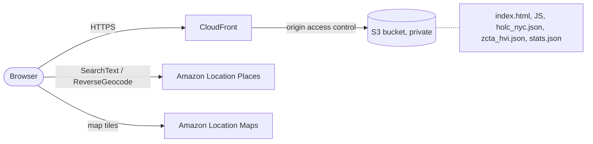

# Redlines to Heatlines: NYC

A map that lays the 1930s federal redlining grades of New York City over today's heat vulnerability scores, so you can see where the two line up. Built for the AWS Builder Center weekend challenge "Map it".

Live: https://d2qzucm1xjsw12.cloudfront.net/

## What is on the map

- **HOLC redlining, 1930s.** 403 neighbourhood polygons graded A (best) to D (hazardous) by the Home Owners' Loan Corporation, from Mapping Inequality (University of Richmond and partners), licensed CC BY-NC-SA 4.0. Six polygons have no grade and one is grade E; they are drawn but left out of the grade statistics.
- **Heat Vulnerability Index.** The NYC Health Department score from 1 (lowest) to 5 (highest) for 184 ZIP code tabulation areas.

Click anywhere to see the grade and heat score at that point, plus the street address from Amazon Location Service. A five-stop tour (East New York, South Bronx, Central Harlem, Riverdale and Park Slope, which is a counterexample) flies to places where the two layers agree or do not. You can also search an address. Switch between Redlining, Heat and Both with the buttons on the map. Keyboard and screen reader users can use "Inspect map centre" to read the zones under the middle of the map. The URL keeps the selected point (`?lat=&lng=&name=`) so a view can be shared, and the Copy link button copies it.

## The number in the sidebar

`scripts/build-stats.mjs` intersects every graded HOLC polygon with every ZIP area, adds up land area, and writes `public/data/stats.json`. For each grade it reports the share of land that sits in ZIPs scored 4 or 5. Area weighting avoids the arbitrary choice of one point per polygon.

Result: 58.8% of grade D land and 0.5% of grade A land, against 49.3% across all graded land. The same script also writes a per-borough table (shown in the sidebar). The pattern is strong in the Bronx (D 100%, C 76%) and Queens, weak in Manhattan, and absent in Staten Island, where grade D land is mostly in low-heat ZIPs. Read it with care: heat scores are quintile ranks, so 74 of 184 ZIPs (40%) score 4 or 5 by design, grade A is only 16 small polygons, ZIP scores are coarser than the 1930s zones, and the link is a correlation.

Re-run it with `node scripts/build-stats.mjs` after changing either data file.

## AWS services

| Service | Use |
|---|---|
| Amazon Location Service (Places) | Address search with `SearchText`, and `ReverseGeocode` to show the street address of any clicked point. Both are called from the browser with a referrer-restricted API key (allowed actions: those two only). |
| Amazon Location Service (Maps) | Basemap tiles in the Monochrome style, chosen so the data layers stand out. Needs `VITE_AWS_LOCATION_MAP_KEY`, a key allowed for `geo-maps:GetTile` only. Without it the app falls back to the free CARTO Positron style. |
| Amazon S3 | Holds the built site and the two GeoJSON files plus `stats.json`. The bucket is private. |
| Amazon CloudFront | Serves everything over HTTPS with compression (the 1.6 MB ZIP file goes out at about 440 KB). Origin access control keeps the bucket closed. |

### Architecture



I did not use Lambda, Athena or a database. Both datasets are small and static (about 1.6 MB of ZIP polygons, 0.6 MB of HOLC polygons), so the point lookups run in the browser with Turf and the statistics are computed ahead of time by a script. A server would add cost and moving parts without adding anything to the map.

## Data sources

| Data | Source | Notes |
|---|---|---|
| HOLC grades | [Mapping Inequality](https://dsl.richmond.edu/panorama/redlining/) (`static/mappinginequality.json`) | CC BY-NC-SA 4.0. Filtered to New York state, the five boroughs, and slimmed to the properties the app uses. |
| Heat scores | NYC Open Data dataset [`4mhf-duep`](https://data.cityofnewyork.us/resource/4mhf-duep) "Heat Vulnerability Index Rankings", NYC Department of Health and Mental Hygiene | 2024 release. Inputs are from 2016 to 2020, including August 2020 surface temperature, so this is not live heat data. Geography is the 2020 ZIP code tabulation area. |

`node scripts/prepare-data.mjs` re-downloads both sources and checks `public/data/*.json` against them (HOLC polygon count and grades, HVI score for every ZIP). Add `--write` to overwrite the files. The ZIP polygon geometry itself was prepared by hand once and is not rebuilt by the script, so only the scores are verified.

## Run it

```bash
npm install
npm run dev      # http://localhost:5173
npm run build
```

Copy `.env.example` to `.env` and fill it in (`.env` is git-ignored; Vite inlines these values into the build, so keep both keys referrer-restricted):

```
VITE_AWS_LOCATION_API_KEY=...      # Places search key (required for address search)
VITE_AWS_LOCATION_MAP_KEY=...      # turns on the Amazon Location basemap
```

## Deploy

`./deploy.sh` builds, syncs `dist/` to the S3 bucket with long cache headers on hashed assets, and invalidates `index.html` and `data/*` on the CloudFront distribution.

## Licence

The code is MIT licensed (see `LICENSE`). The data is not covered by that licence:

- `public/data/holc_nyc.json` is derived from Mapping Inequality (University of Richmond and partners) and stays under CC BY-NC-SA 4.0. Credit the source, share adaptations under the same terms, and do not use it commercially.
- `public/data/zcta_hvi.json` comes from the NYC Health Department Heat Vulnerability Index. Check the NYC Open Data terms before reuse.

## Stack

React 19, Vite, MapLibre GL JS 6 through react-map-gl, Turf for point lookups. maplibre-gl 6 needs its worker file passed in by hand (`src/main.tsx`), since Vite does not ship it next to the bundle.
